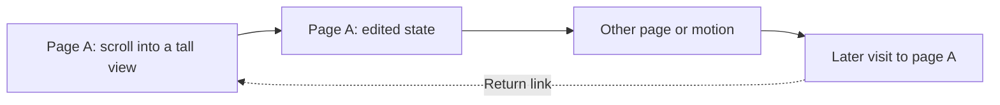

# Video to canvas: proposed design

Status: research complete; proof proposed. No canvas feature is implemented.

Start with a short narrated recording that unfolds into a tall page view.
Place changed content to its right. Keep each part linked to the video moment that supplied it.
This tests the central idea: convert time into space, then recover time through interaction.

Research supports this experiment. It does not establish accuracy, speed, or usefulness on real recordings.
The [proof plan](proof-plan.md) defines the next decision. The [research review](research-review.md) records evidence and recommendation decisions.
The [original intent](intent-brief.md) and [full Pro report](pro-output/video-to-canvas-report.md) preserve the broader vision.

## Experience

The main view follows the recording from left to right.
Within a page, vertical position keeps the content's observed geometry.
Horizontal distance is layout space; timestamps and the existing timeline show elapsed time.

| Recorded action | Canvas result |
| --- | --- |
| Scroll unchanged content | Extend a tall view from overlapping frames. |
| Edit content | Start a changed state to the right. Keep the earlier state available. |
| Change content frequently | Show a compact stack of moments that can expand. |
| Play an animation | Show a poster with a playable source interval. |
| Return to earlier content | Keep the later visit in sequence and link it to the earlier visit. |
| Speak while navigating | Show nearby transcript chunks linked by time. |
| Switch among slides and code | Show slide states, supported code scrolls, and motion intervals in one sequence. |
| Select a large region | Capture the observed composite, including regions larger than a video frame. |

This is a conceptual sequence, not measured output.
A changed state can contain unknown areas. It must not silently borrow those areas from the earlier state.

At overview scale, show visit titles, times, and previews.
At reading scale, show the page content and nearby narration.
Selecting content reveals its source moment and plays that part of the original recording.
Use one shared player. Keep keyboard navigation and a chronological list available.

Start with transcript text in a side rail to keep page text readable.
Its meaning is “spoken during this visit.” Timing alone does not prove which object the speaker meant.
The transcript overlay placement remains open for the interaction proof.

## What an image means

The composite shows content observed across several times.
It does not claim that every part existed together at one instant.
Keep this explanation at the view level. Show detailed source information when a person selects content.

Each displayed image patch must map to one decoded frame, its presentation time, and a source pixel rectangle.
Preserve this mapping after layout changes and during export.
Do not blend different moments across text. Do not fill content that was never observed.

Keep three concepts distinct:

- A **surface** defines the coordinate space of a page or selected pane.
- A **state** groups observations with no detected conflicting content.
- A **visit** records a chronological occurrence, including a return to an earlier surface.

These concepts do not require separate services, stores, or classes.
Use one small JSON file. Start with nested visits and patches; share records only when the proof needs them.
The [Pro data example](pro-output/video-to-canvas-proof-plan.md#small-proposed-json-example) explains the coordinate rules.
Its full normalized structure is a reference, not a required schema.

| Required information | Purpose |
| --- | --- |
| Video identity, size, time base, and media-time mapping | Identify the recording and interpret decoded frame times. |
| Visit interval, state, surface, and layout position | Preserve sequence without changing source geometry. |
| Patch frame, source rectangle, translation, and owned output rectangle | Resolve every displayed part back to source pixels. |
| Refusal reason or motion interval | Preserve transitions that cannot form a static join. |
| Transcript source range and associated visits | Keep narration linked without inventing visual meaning. |

Unknown space has no source target.
A later visit uses its own source moment, even if storage reuses identical image bytes.
Show a confirmed return only when recorded visual evidence supports it.
A matching URL can suggest a candidate; it cannot prove a matching state.

## First proof

Use a 60–90 second narrated product recording with one selected viewport.
Include a scroll across three viewport heights, one visible edit, and one jump with insufficient overlap.

Produce a tall view, a changed-state card, a refused-join card, source playback, and a sentence rail.
Compare it with ordinary video review and a useful change-selected storyboard.
The proof must reconstruct page geometry automatically after the initial viewport selection.

The proposed initial method estimates translation between images and verifies the result before joining them.
OpenCV supplies phase correlation for translation estimates; its response is not a probability that a join is correct.
The API exists in the proposed 4.14 source. Accuracy still needs measurement. [OpenCV API](https://docs.opencv.org/4.13.0/d7/df3/group__imgproc__motion.html), [tagged source](https://raw.githubusercontent.com/opencv/opencv/4.14.0/modules/imgproc/include/opencv2/imgproc.hpp).

1. Decode frames with their actual presentation times. Keep a bounded work buffer.
2. Start with two candidate frames per second and a cheap change check at recorded cadence.
3. Use nearer frames when scroll speed threatens overlap. Audit small changes at source resolution.
4. Estimate translation within the selected viewport. Compare several informative regions.
5. Verify source-resolution alignment, unique support, and content differences.
6. Join supported observations. Otherwise keep a timed card with a short reason.

Fixed headers, repeated text, blank regions, cursor motion, and content edits must not create false joins.
Split on uncertain zoom, reflow, window movement, or independent pane motion.
An explicit single-pane crop can be a separate experiment.
One successful page does not establish support for virtualized lists or general video.

Use integer-aligned source crops for output. Preserve readable glyphs when choosing a seam.
If a clean seam is unavailable, keep overlapping cards.
The report's numerical confidence thresholds are calibration seeds, not accepted defaults.

## Repository fit

Use explicit offline analysis in the existing checkout.
Propose `scripts/analyze_canvas.py`, `canvas.json`, and bounded images under `canvas/`.
These paths describe future work. This research PR does not create the analyzer.

| Current file | Proposed role |
| --- | --- |
| [process_session.py](../../../scripts/process_session.py) | Embed valid canvas data into the existing viewer output. |
| [viewer.html](../../../scripts/viewer.html) | First canvas interaction, using the existing video element and timeline. |
| [SessionModel.swift](../../../Sources/ContextRecorder/Library/SessionModel.swift) | Later native view shares the current player and `seek` function. |
| [Review.swift](../../../Sources/ContextRecorder/Library/Review.swift) | Note changes keep their existing processing path; they must not rerun video analysis. |
| [PgmExport.swift](../../../Sources/ContextRecorder/Export/PgmExport.swift) | Later composite export requires its own image and source-map meaning. |

The HTML viewer already embeds session data through `write_viewer`.
Use this route for the first proof. Do not require a local server or a new package project.
Keep the SwiftUI integration decision until the interaction proves useful.

Run the proposed analyzer only on request.
Treat its images and layout as derived output. Keep source recordings, notes, and export mappings intact.
Match derived output to the video and analysis settings before use.
An absent or unusable canvas must leave ordinary session review usable.

Actual decoded frame times are essential.
Current screenshot marks retain the keypress time, but the image is captured after region selection.
Browser events also receive a host offset on arrival and can arrive from a reconnect queue.
These records provide context, not exact frame-exposure evidence. See the [checked source findings](research-review.md#repository-checks).

The first candidate uses optional Python analysis with OpenCV and NumPy.
OpenCV 4.14.0.94 has published macOS wheels; local compatibility remains untested. [Package record](https://pypi.org/project/opencv-python-headless/4.14.0.94/).
Resolve and pin the environment only during an authorized implementation.
Apple Vision remains an alternative if Python distribution becomes the deciding cost.
Do not maintain two analysis engines for optionality.

Before writing substantial stitching code, inspect a pinned component from [scrollsnap](https://github.com/Haruhiyuki/scrollsnap).
Its project describes source-linked scroll reconstruction, but reuse has not been validated.
Its metadata names a different source URL. Resolve that difference before adoption. [Package metadata](https://raw.githubusercontent.com/Haruhiyuki/scrollsnap/main/pyproject.toml).

## Later steps

Keep these parts of the desired experience, with separate acceptance checks:

- Motion posters, interval playback, and expandable frame stacks.
- Verified return arrows, with distinct later visits and their narration.
- Transcript refinement using raw token times where useful.
- Composite region capture with a source map and visible multi-time labeling.
- Native canvas integration after the HTML proof proves useful.
- Browser scroll measurements only when they solve a measured visual failure.

Keep large views bounded with image patches or tiles and visible-region loading.
Do not allocate a whole hour of content as one bitmap.
Tile sizes, cache budgets, and export limits remain measured implementation choices.

## Open decisions

The proof should resolve whether one viewport selection is acceptable and whether the canvas saves useful review time.
It should also test transcript placement and how much source detail belongs in the main view.
Automatic grouping, exact dependency choice, return detection, and long-session costs remain unproven.
No choice here authorizes a full implementation, merge, or deployment.
