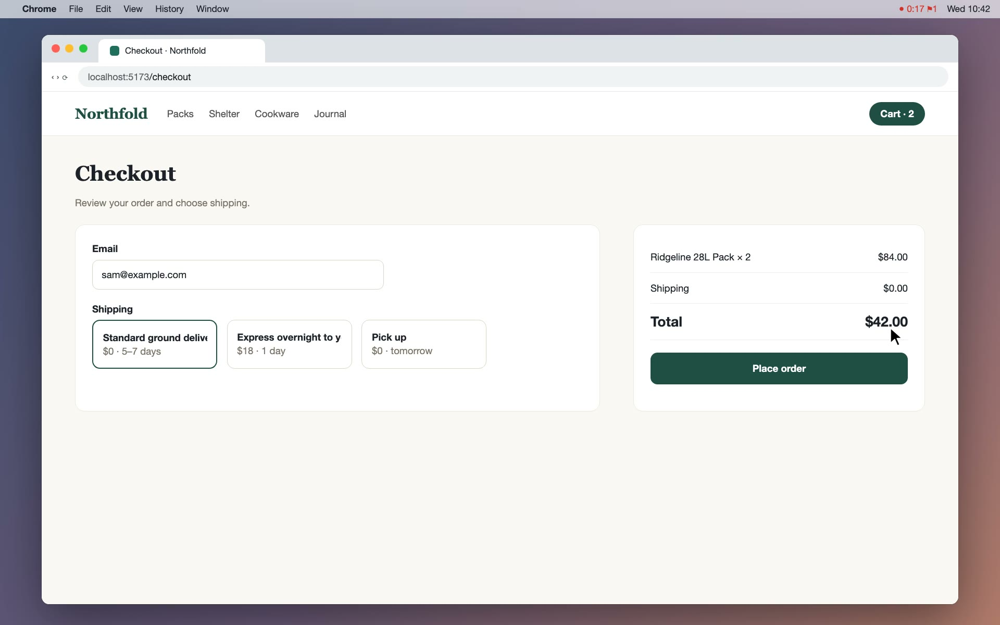

## 001 · 0:17 · On checkout, the line item says $84 for two packs, but the total says…

> Okay, I'm checking the checkout flow on the shop before the release. I set the quantity to two and click add to cart. On checkout, the line item says $84 for two packs, but the total says 42 ⚑, it looks like the total ignores the quantity. And the express shipping option is cut off, so you can't read it

- **App:** Google Chrome (`com.google.Chrome`)
- **Window:** Checkout · Northfold
- **URL:** http://localhost:5173/checkout
- **Page title:** Checkout · Northfold
- **Video:** `recording.mp4` @ 17.0s
- **Kind:** mark

**Page**

- **Under mouse:** `aside.summary > div.row > span.total` · “$42.00” · in CheckoutPage › OrderSummary › OrderTotal
  - source: `/src/checkout/OrderTotal.tsx:14:7`
  - `<OrderTotal>` props: items="[2 items]", shipping=0, currency="USD"
- **Recent click:** `[data-testid="add-to-cart"]` “Add to cart”
