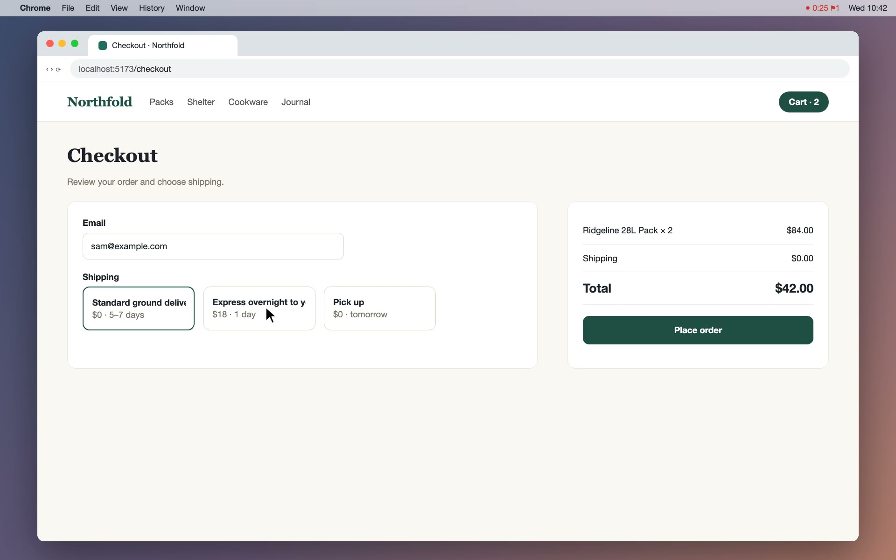

## 002 · 0:25 · And the express shipping option is cut off, so you can't read it.

> quantity to two and click add to cart. On checkout, the line item says $84 for two packs, but the total says 42, it looks like the total ignores the quantity. And the express shipping option is cut off, so you can't ⚑ read it. Now settings, I'll switch the theme to dark and save

- **App:** Google Chrome (`com.google.Chrome`)
- **Window:** Checkout · Northfold
- **URL:** http://localhost:5173/checkout
- **Page title:** Checkout · Northfold
- **Video:** `recording.mp4` @ 25.5s
- **Kind:** mark

**Page**

- **Under mouse:** `#ship-express > div.t` · “Express overnight to your door” · in CheckoutPage › ShippingPicker › ShippingOption
  - source: `/src/checkout/ShippingOption.tsx:22:7`
- **Recent click:** `[data-testid="add-to-cart"]` “Add to cart”
