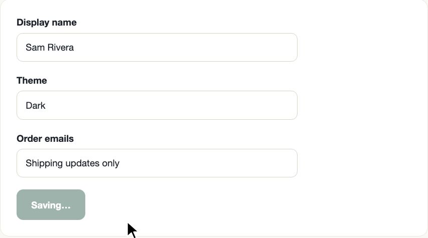

## 003 · 0:40 · Saving fails with just something went wrong, and the button is stuck…

> And the express shipping option is cut off, so you can't read it. Now settings, I'll switch the theme to dark and save. Saving fails with just something went wrong, and the button is ⚑ stuck on saving.

- **App:** Google Chrome (`com.google.Chrome`)
- **Window:** Settings · Northfold
- **URL:** http://localhost:5173/account/settings
- **Page title:** Settings · Northfold
- **Video:** `recording.mp4` @ 40.0s
- **Kind:** screenshot

**Page**

- **Under mouse:** `[data-testid="save-settings"]` · “Save settings” · in SettingsPage › SettingsForm › SaveButton
  - source: `/src/account/SettingsForm.tsx:58:7`

**Inside the screenshot region** _(mapped via pointer)_

- `#theme` “Dark” · `/src/account/ThemeSelect.tsx:12`
- `[data-testid="save-settings"]` “Saving…” · `/src/account/SettingsForm.tsx:58:7`

- **Recent click:** `[data-testid="add-to-cart"]` “Add to cart”
- **Recent click:** `[data-testid="save-settings"]` “Save settings”

**Recent errors / failed requests**

- PUT http://localhost:5173/api/account/settings → 500 (212 ms) — {"error":"theme must be one of: light, system"}
- console.error: SettingsForm: save failed (500)
