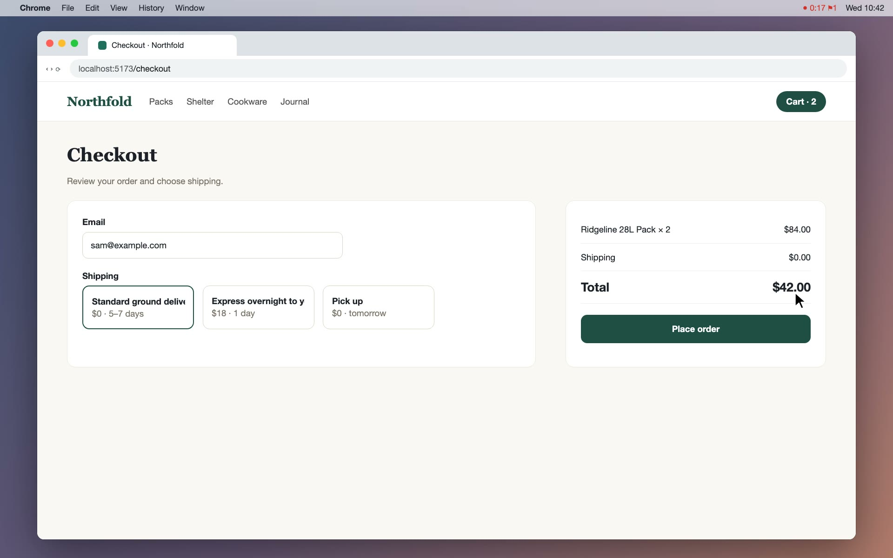
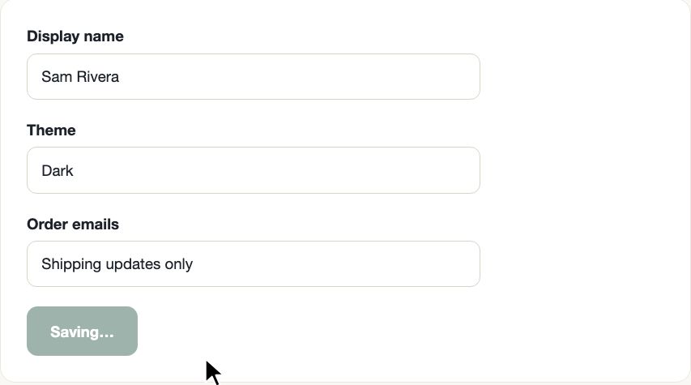

# Northfold checkout pass (2026-11-19_10-42-00)

3 marks · video: `recording.mp4`

## 001 · 0:17 · On checkout, the line item says $84 for two packs, but the total says…

> Okay, I'm checking the checkout flow on the shop before the release. I set the quantity to two and click add to cart. On checkout, the line item says $84 for two packs, but the total says 42 ⚑, it looks like the total ignores the quantity. And the express shipping option is cut off, so you can't read it

- **App:** Google Chrome (`com.google.Chrome`)
- **Window:** Checkout · Northfold
- **URL:** http://localhost:5173/checkout
- **Page title:** Checkout · Northfold
- **Video:** `recording.mp4` @ 17.0s
- **Kind:** mark

**Page**

- **Under mouse:** `aside.summary > div.row > span.total` · “$42.00” · in CheckoutPage › OrderSummary › OrderTotal
  - source: `/src/checkout/OrderTotal.tsx:14:7`
  - `<OrderTotal>` props: items="[2 items]", shipping=0, currency="USD"
- **Recent click:** `[data-testid="add-to-cart"]` “Add to cart”

## 002 · 0:25 · And the express shipping option is cut off, so you can't read it.

> quantity to two and click add to cart. On checkout, the line item says $84 for two packs, but the total says 42, it looks like the total ignores the quantity. And the express shipping option is cut off, so you can't ⚑ read it. Now settings, I'll switch the theme to dark and save

- **App:** Google Chrome (`com.google.Chrome`)
- **Window:** Checkout · Northfold
- **URL:** http://localhost:5173/checkout
- **Page title:** Checkout · Northfold
- **Video:** `recording.mp4` @ 25.5s
- **Kind:** mark

**Page**

- **Under mouse:** `#ship-express > div.t` · “Express overnight to your door” · in CheckoutPage › ShippingPicker › ShippingOption
  - source: `/src/checkout/ShippingOption.tsx:22:7`
- **Recent click:** `[data-testid="add-to-cart"]` “Add to cart”

## 003 · 0:40 · Saving fails with just something went wrong, and the button is stuck…

> . And the express shipping option is cut off, so you can't read it. Now settings, I'll switch the theme to dark and save. Saving fails with just something went wrong, and the button is ⚑ stuck on saving.

- **App:** Google Chrome (`com.google.Chrome`)
- **Window:** Settings · Northfold
- **URL:** http://localhost:5173/account/settings
- **Page title:** Settings · Northfold
- **Video:** `recording.mp4` @ 40.0s
- **Kind:** screenshot

**Page**

- **Under mouse:** `[data-testid="save-settings"]` · “Save settings” · in SettingsPage › SettingsForm › SaveButton
  - source: `/src/account/SettingsForm.tsx:58:7`

**Inside the screenshot region** _(mapped via pointer)_

- `#theme` “Dark” · `/src/account/ThemeSelect.tsx:12`
- `[data-testid="save-settings"]` “Saving…” · `/src/account/SettingsForm.tsx:58:7`

- **Recent click:** `[data-testid="add-to-cart"]` “Add to cart”
- **Recent click:** `[data-testid="save-settings"]` “Save settings”

**Recent errors / failed requests**

- PUT http://localhost:5173/api/account/settings → 500 (212 ms) — {"error":"theme must be one of: light, system"}
- console.error: SettingsForm: save failed (500)

---

## Full transcript

- `0:00` Okay, I'm checking the checkout flow on the shop before the release.
- `0:04` I set the quantity to two and click add to cart.
- `0:11` On checkout, the line item says $84 for two packs, but the total says 42, it looks like the total ignores the quantity.
- `0:22` And the express shipping option is cut off, so you can't read it.
- `0:30` Now settings, I'll switch the theme to dark and save.
- `0:36` Saving fails with just something went wrong, and the button is stuck on saving.
